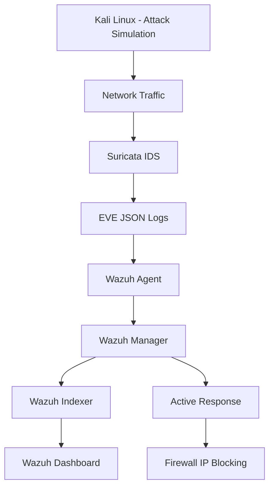
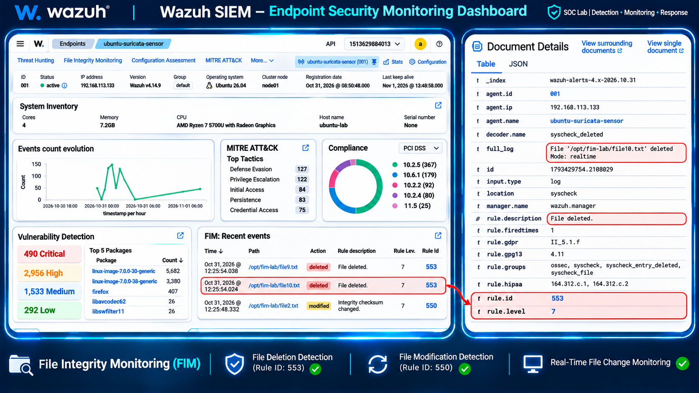
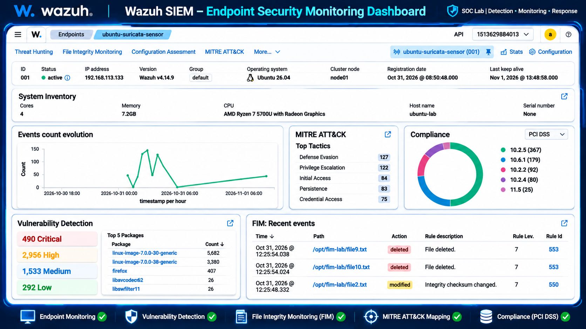
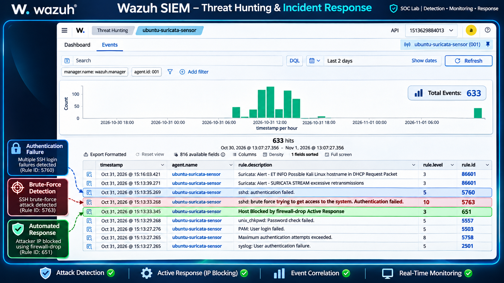
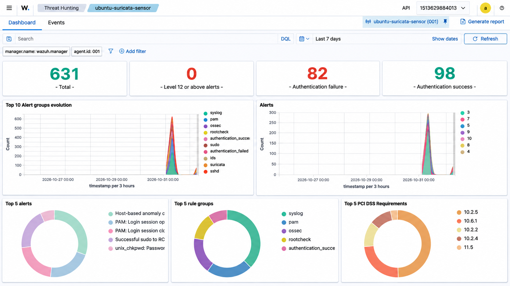
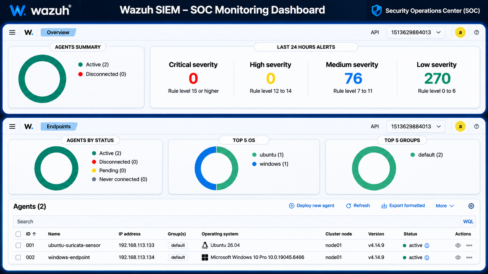

# Wazuh SIEM Integration with Suricata IDS
### Automated Threat Detection & Incident Response

A hands-on Security Operations Center (SOC) lab integrating **Wazuh SIEM** with **Suricata IDS** to monitor security events, detect suspicious network activity, investigate threats, and automate incident response.

## Project Overview
# 🛡️ Wazuh SIEM + Suricata IDS
### Automated Threat Detection & Incident Response

## 👨‍💻 Project Overview

Developed a hands-on Security Operations Center (SOC) lab by integrating **Wazuh SIEM** with **Suricata IDS** to monitor security events, detect suspicious network activity, investigate threats, and automate incident response.

The project demonstrates practical Blue Team operations, including security event monitoring, SSH brute-force detection, firewall-based IP blocking, File Integrity Monitoring, and vulnerability detection.

## 🎯 Key Features

| Security Capability | Implementation |
|---|---|
| SIEM Monitoring | Centralized monitoring using Wazuh |
| Network Threat Detection | Suricata IDS integration |
| SSH Brute-Force Detection | Wazuh rule-based detection |
| Automated Incident Response | Firewall IP blocking using Active Response |
| File Integrity Monitoring | Detection of file modifications and deletions |
| Vulnerability Detection | Endpoint vulnerability monitoring |

## 🧰 Technology Stack

- **SIEM:** Wazuh
- **IDS:** Suricata
- **Operating Systems:** Ubuntu Linux, Kali Linux
- **Containerization:** Docker
- **Firewall:** iptables
- **Virtualization:** VMware
- **Log Format:** EVE JSON

## 📸 Project Highlights

Explore the screenshots and implementation evidence below.

- SIEM monitoring dashboard
- Network threat detection
- SSH brute-force detection
- Automated firewall response
- File Integrity Monitoring

## 📂 Project Documentation

- [Implementation Guide](documentation/implementation-guide.md)
- [SSH Brute-Force Detection](detection-rules/ssh-bruteforce.md)
- [SOC Detection Use Cases](detection-rules/detection-use-cases.md)
- [Testing & Validation](testing/test-cases.md)

## 👨‍🎓 About the Developer

**Bhupender Dhankhar**

B.Tech – Computer Science & Engineering (Cyber Security)  
Gurugram University

Aspiring SOC Analyst | Interested in SIEM, Threat Detection, Network Security & Incident Response.

[LinkedIn Profile](https://www.linkedin.com/in/bhupender-dhankhar-41299a351)

## Architecture

## Project Screenshots

### 1. Project Overview

### 2. SOC Monitoring Dashboard

### 3. Threat Detection

### 4. Threat Hunting

### 5. Wazuh Dashboard

## Lab Environment

| Component | Purpose |
|---|---|
| Kali Linux | Controlled attack simulation |
| Ubuntu Linux | Suricata monitoring sensor |
| Suricata IDS | Network threat detection |
| Wazuh SIEM | Centralized security monitoring |
| Docker | Wazuh deployment |
| iptables | Firewall-based response |
| VMware | Virtual lab environment |

## Key Features & Implementation

### 1. SIEM and IDS Integration
- Integrated Suricata with Wazuh for centralized security monitoring.
- Configured Suricata EVE JSON log collection.
- Monitored network security events through the Wazuh dashboard.

### 2. SSH Brute-Force Detection
- Configured SSH authentication monitoring.
- Used Wazuh rule 5763 to detect repeated failed SSH login attempts.
- Analyzed suspicious authentication activity.

### 3. Automated Incident Response
- Configured Wazuh Active Response using `firewall-drop`.
- Implemented automatic source IP blocking for matching SSH brute-force alerts.
- Configured a 180-second response timeout.

### 4. File Integrity Monitoring (FIM)
- Monitored files and directories for unauthorized changes.
- Detected file modifications and deletions.
- Reviewed integrity alerts through Wazuh.

### 5. Vulnerability Detection
- Enabled Wazuh Vulnerability Detection.
- Collected endpoint inventory information.
- Monitored vulnerability findings for connected systems.

## Tools & Technologies

- **SIEM:** Wazuh
- **IDS:** Suricata
- **Operating Systems:** Ubuntu, Kali Linux
- **Containerization:** Docker
- **Firewall:** iptables
- **Virtualization:** VMware
- **Log Format:** EVE JSON
## Detection Logic & Incident Response Workflow

### 1. SSH Brute-Force Detection

- Monitored SSH authentication events on the Ubuntu endpoint.
- Used Wazuh rule ID `5763` to detect repeated failed SSH login attempts.
- Investigated suspicious source IP activity through security alerts.

### 2. Automated IP Blocking

- Configured Wazuh Active Response using the `firewall-drop` command.
- Triggered automated response when the configured detection rule matched.
- Configured a response timeout of 180 seconds.
- Verified firewall-blocking activity through Wazuh alerts.

### 3. Suricata Event Monitoring

- Configured Suricata to generate network security events in EVE JSON format.
- Collected Suricata logs through the Wazuh agent.
- Monitored network-related security events in the Wazuh dashboard.

### 4. File Integrity Monitoring

- Enabled Wazuh FIM to monitor selected files and directories.
- Detected file modifications and deletions.
- Investigated generated integrity alerts.

### 5. Vulnerability Detection

- Enabled Wazuh Vulnerability Detection.
- Collected endpoint software and operating system inventory.
- Reviewed vulnerability findings through the Wazuh dashboard.

## Incident Response Workflow

1. Generate authorized test activity in the lab.
2. Collect security events from the monitored endpoint.
3. Analyze events using Wazuh detection rules.
4. Generate security alerts for suspicious activity.
5. Trigger Active Response for configured detection conditions.
6. Review alerts and verify response actions in the dashboard.
## Project Outcomes

- Established centralized security monitoring.
- Detected suspicious SSH authentication activity.
- Implemented automated firewall blocking through Active Response.
- Monitored file integrity changes.
- Enabled vulnerability monitoring for endpoints.

## Repository Contents

- `screenshots/` – Project dashboards and implementation evidence.
- `README.md` – Project overview, architecture, and documentation.

## Learning Outcomes

- Practical understanding of SIEM and IDS integration.
- Security event monitoring and alert investigation.
- SSH brute-force detection.
- Automated incident response.
- File Integrity Monitoring and vulnerability management.

## Disclaimer

This project was developed for educational purposes in an isolated virtual lab. All security testing was performed on systems under my control or with authorization.

## Author

**Bhupender Dhankhar**

Cybersecurity Student | Aspiring SOC Analyst

[LinkedIn](https://www.linkedin.com/in/bhupender-dhankhar-41299a351)
